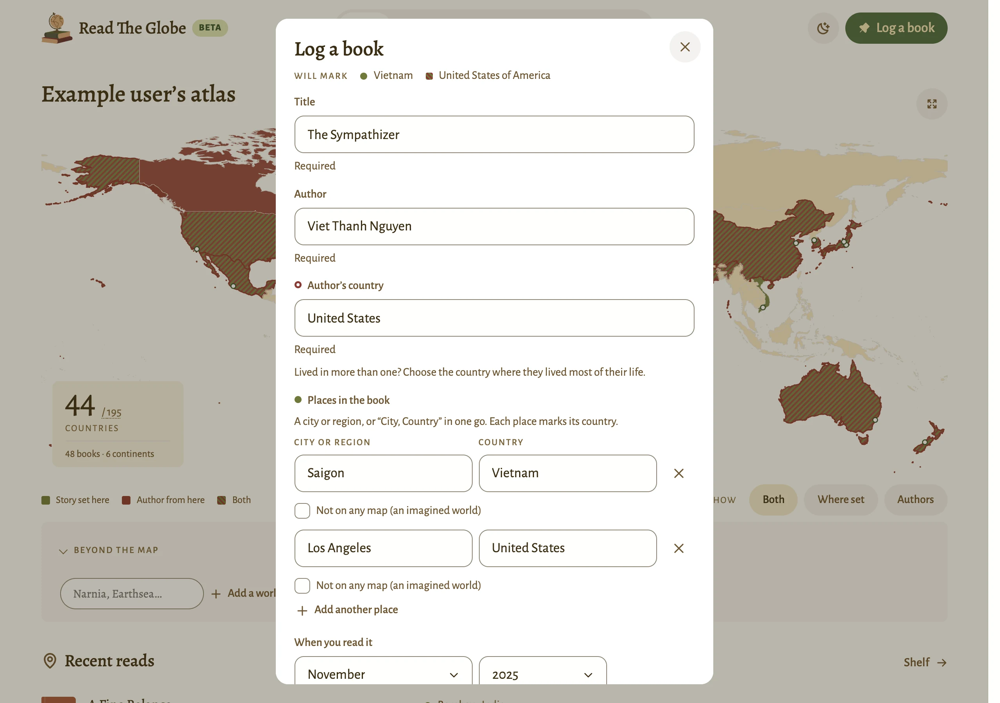
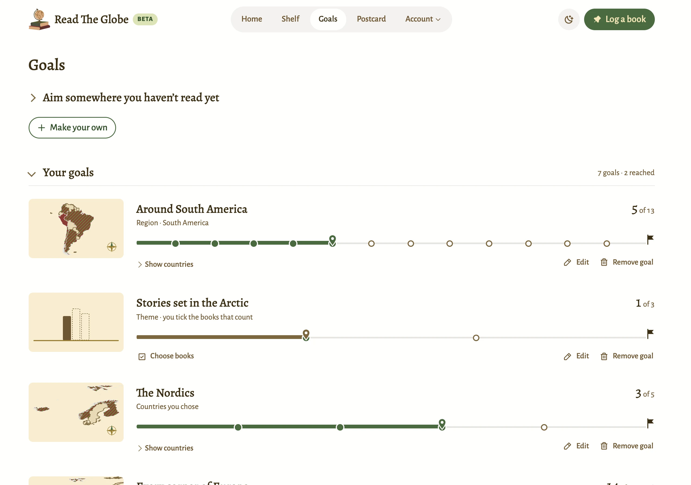
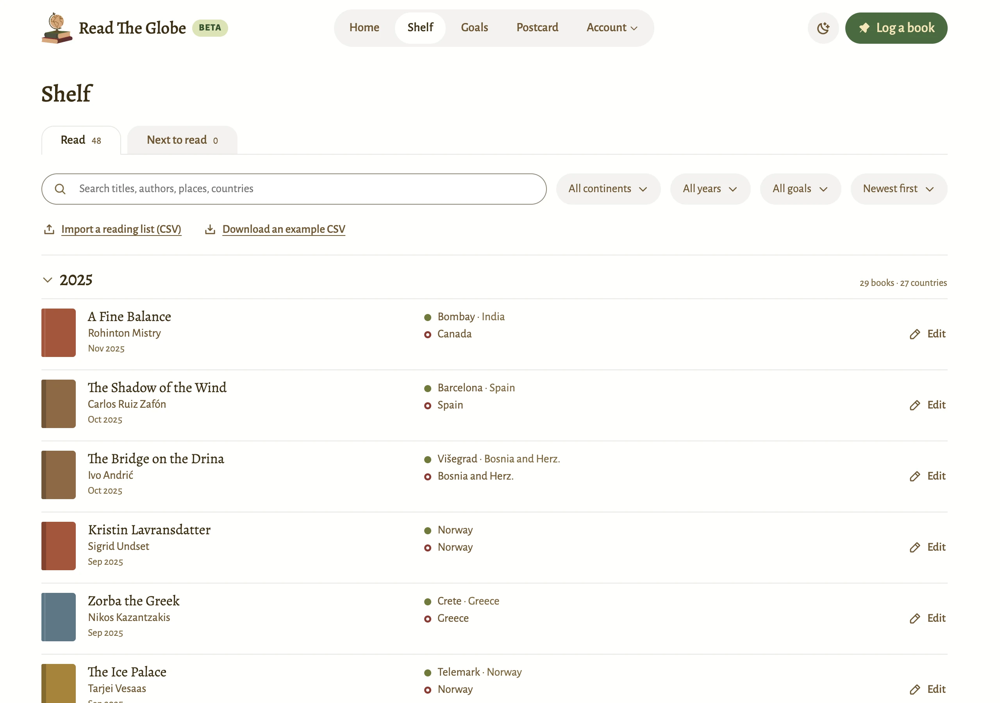
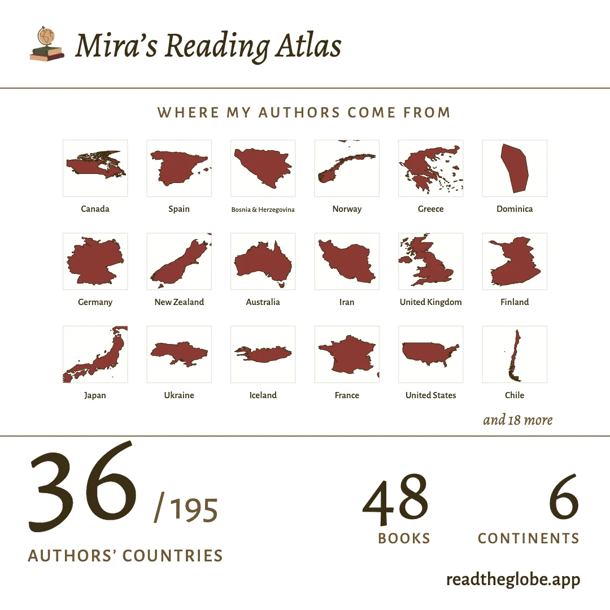
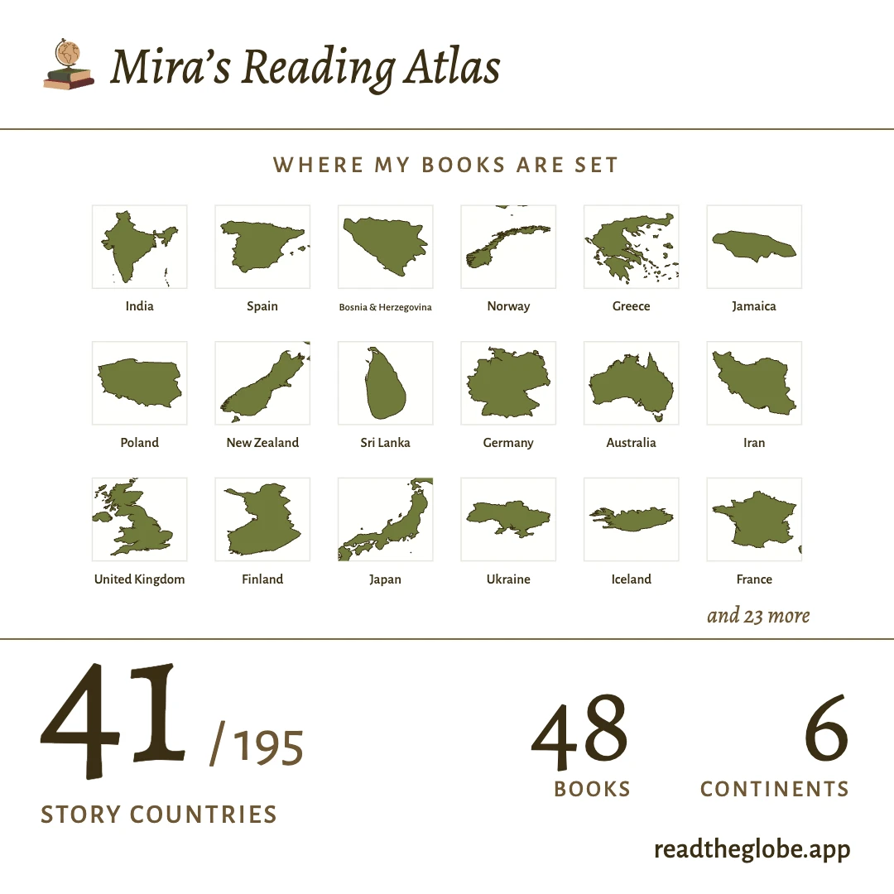
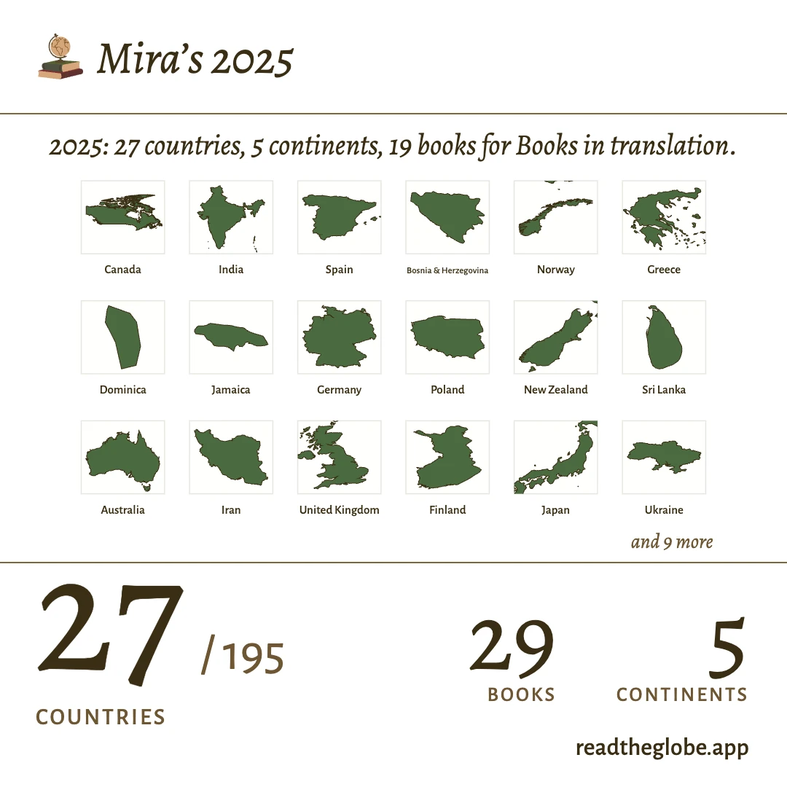

# Read The Globe

[](https://github.com/yelyty/read-the-globe/actions/workflows/test.yml)
[](https://react.dev)

[](LICENSE)

Read The Globe is a reading log with a world map.

When you log a novel, the map shows two countries:

- The country where the story occurs. The map shows this country in olive.
- The country of the author. The map shows this country in rust.

If a country is both, the map shows it with stripes.
The map keeps all your books. Thus, you can see how many countries your books show.



## Features

- **Log a book.** Type the title, the author, the country of the author and the places in the story. Before you save the book, the form shows the countries that it will mark.
- **Atlas.** The world map shows all the countries of your books.
- **Goals.** Select a region, a set of countries or a theme. Each applicable book moves you nearer to the end of the goal.
- **Shelf.** Search for a book by title, author, place or country.
- **Import and export.** Import a reading list from a CSV file. Export your reading list to a CSV file.
- **Postcards.** Make an image to share. There are three types of postcard: the countries of your authors, the countries of your stories, or one year of books.
- **Languages.** The app is available in English, Czech and Ukrainian.
- **Themes.** The app has a day theme and a night theme.

| Goals                                           | Shelf                                           |
| ----------------------------------------------- | ----------------------------------------------- |
|  |  |

| Postcard: authors                                             | Postcard: settings                                              | Postcard: one year                                      |
| ------------------------------------------------------------- | --------------------------------------------------------------- | ------------------------------------------------------- |
|  |  |  |

## Technology

| Function                | Tool                                 |
| ----------------------- | ------------------------------------ |
| User interface          | React 19, TypeScript                 |
| Build                   | Vite                                 |
| Routes                  | TanStack Router                      |
| Data requests           | TanStack Query                       |
| Authentication and data | Supabase                             |
| Styles                  | vanilla-extract                      |
| Map                     | d3-geo, react-simple-maps, TopoJSON  |
| Translations            | Paraglide (inlang)                   |
| Tests                   | Vitest                               |
| Components              | Storybook                            |
| Code quality            | ESLint, Prettier, Husky, lint-staged |
| Hosting                 | Netlify                              |

## Start the app on your computer

### Requirements

- Node.js 22
- pnpm 10
- A Supabase project

### Procedure

> **WARNING:** Put only the publishable (anon) key in the `.env` file. All users can see this key. Do not put the service_role key in this file.

1. Install the dependencies:

   ```bash
   pnpm install
   ```

2. Copy the example environment file:

   ```bash
   cp .env.example .env
   ```

3. Open the `.env` file.
4. Type the URL of your Supabase project in `VITE_SUPABASE_URL`.
5. Type the publishable key of your Supabase project in `VITE_SUPABASE_PUBLISHABLE_KEY`.
6. Start the development server:

   ```bash
   pnpm dev
   ```

## Commands

| Command          | Function                                                              |
| ---------------- | --------------------------------------------------------------------- |
| `pnpm dev`       | Starts the development server.                                        |
| `pnpm build`     | Does a type check and makes the production build.                     |
| `pnpm preview`   | Shows the production build on your computer.                          |
| `pnpm test`      | Runs the tests.                                                       |
| `pnpm lint`      | Does a check of the code with ESLint.                                 |
| `pnpm format`    | Formats the code with Prettier.                                       |
| `pnpm storybook` | Starts Storybook on port 6006.                                        |
| `pnpm i18n`      | Compiles the translations. The other commands run this command first. |

## Project structure

```
src/
  routes/      Routes for TanStack Router
  pages/       Page components
  features/    Large feature modules, for example LogBook
  components/  Shared components. Each component has Storybook stories.
  layout/      Layouts, header and footer
  api/         Supabase requests
  hooks/       Shared React hooks
  utils/       Helper functions and their unit tests
  styles/      Theme and global styles
messages/      Translations (en, cs, uk)
```

## Add a translation

1. Add the new key to `messages/en.json`.
2. Add the same key to `messages/cs.json`.
3. Add the same key to `messages/uk.json`.
4. Run the tests:

   ```bash
   pnpm test
   ```

> **NOTE:** The test `src/messages.test.ts` makes sure that the three files have the same keys.

## Map data

The country shapes are from Natural Earth, through world-atlas. These data are in the public domain.

## License

This repository is public, but it is not open source. You can read the source code. You cannot run, copy, change or use the code without written permission. Refer to [LICENSE](LICENSE) for the full terms.
